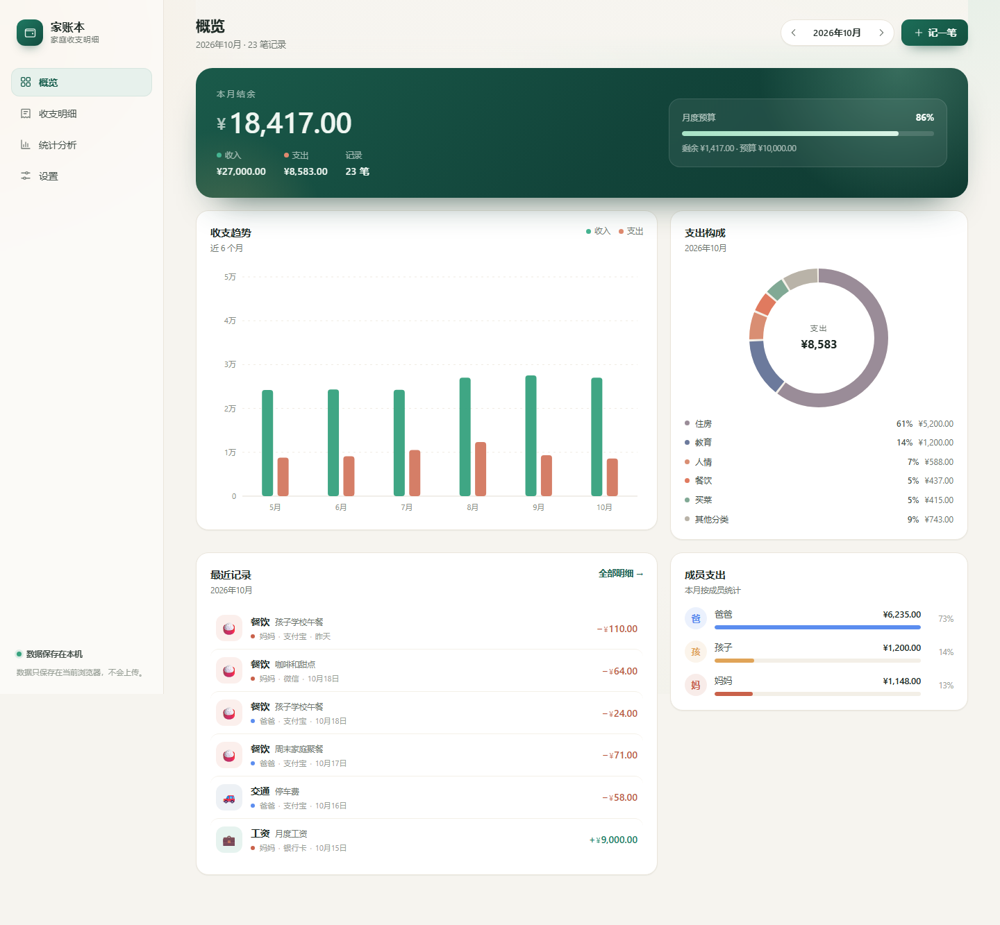
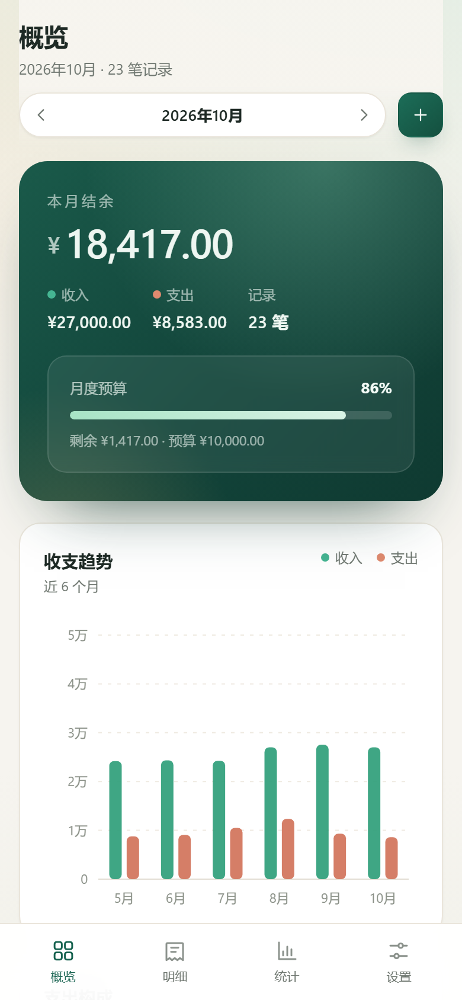

# 家账本 · 家庭收支明细

一个开箱即用的家庭记账单页应用：无后端、无第三方依赖、数据只保存在本机浏览器。支持按成员记账、月度预算、分类统计、JSON 备份与 CSV 导出。



## 功能

- **记一笔**：支出 / 收入、金额、分类、日期、家庭成员、账户、备注
- **概览**：本月收入 / 支出 / 结余、预算进度、近 6 个月收支趋势、支出构成、最近记录、成员支出
- **明细**：按月浏览，关键词搜索，按类型 / 成员 / 分类筛选，按日汇总
- **统计**：本月 / 近 3 月 / 近 6 月 / 今年，KPI、月度对比、分类排行、成员对比、月度明细表
- **设置**：月度预算、家庭成员、分类管理、备份导入导出、清空数据
- **响应式**：桌面侧边栏，手机底部导航 + 底部抽屉式记账面板
- **可安装到手机**：支持 PWA，部署到 HTTPS 后可添加到主屏幕并离线使用
- **本地优先**：无账号、无网络请求，可随时导出迁移

<p align="center">
  
</p>

## 快速开始

直接双击 `index.html` 即可使用。

如果浏览器限制 `file://` 页面的本地存储（部分浏览器/隐私模式），可在项目目录启动一个静态服务器（任选其一，需已安装）：

```powershell
python -m http.server 8080
# 或
npx serve .
```

然后打开 `http://localhost:8080`。

首次打开是空账本：可以直接「记第一笔」，或点「看看示例数据」载入一套可随时清除的演示数据。

## 安装到手机

应用已支持 PWA（`manifest.json` + `sw.js` 离线缓存）。装到手机后可以像普通 App 一样从桌面图标全屏打开，加载过一次后断网也能用。

### 方式一：部署到 HTTPS（推荐）

1. 把**整个项目文件夹**上传到任意静态托管，例如：
   - [Netlify Drop](https://app.netlify.com/drop)：直接把文件夹拖进网页
   - GitHub Pages、Vercel、Cloudflare Pages
2. 用手机浏览器打开分配到的 `https://...` 网址
3. 安装到桌面：
   - **Android Chrome**：右上角 `⋮` →「安装应用」或「添加到主屏幕」
   - **iPhone Safari**：底部「分享」→「添加到主屏幕」
4. 之后从桌面图标打开即可，独立全屏运行

> 安装条件由浏览器判断：需要 HTTPS、manifest、Service Worker。这些项目里都已配置好。

### 方式二：同一 Wi-Fi 临时访问

1. 电脑双击 `start-server.cmd`（或运行 `node server.mjs`）
2. 记下窗口打印的「手机访问 http://192.168.x.x:8080」
3. 手机连同一个 Wi-Fi，用浏览器打开该地址
4. 也可以「添加到主屏幕」，但这只是快捷方式：电脑上的服务必须保持运行，且局域网 HTTP 不启用离线缓存

> 如果 Windows 弹出防火墙提示，请允许 Node.js 访问「专用网络」。

### 手机与电脑的数据

- 数据保存在各自浏览器里，**不会自动同步**
- 迁移：电脑「设置 → 导出备份」→ 手机打开应用 →「设置 → 导入备份」
- iOS 可能清理长期未访问站点的本地数据，建议定期导出 JSON 备份

### 想要 APK 安装包？

当前以 PWA 为主，不经过应用商店。如果需要真正的 Android APK，可以用 Capacitor 把这套静态页面包装成原生壳，需要本机安装 Android Studio 与构建环境。

## 发布到 GitHub Pages

### 一键脚本

项目自带 `tools/publish-github.mjs`，会创建仓库、上传文件、开启 Pages 并等待构建完成。

1. 创建一个 **classic token**（勾选 `repo`）：  
   <https://github.com/settings/tokens/new?scopes=repo&description=family-ledger>
2. 把 Token 单独一行保存到 `%USERPROFILE%\github-token.txt`（不要提交到仓库，也不要发到聊天里）
3. 先预览将上传的文件：
   ```powershell
   node tools/publish-github.mjs --dry-run
   ```
4. 正式发布：
   ```powershell
   node tools/publish-github.mjs --token-file "$env:USERPROFILE\github-token.txt" --repo family-ledger
   ```

脚本完成后会打印 `https://<你的账号>.github.io/family-ledger/`。仓库不存在时会自动创建为 **public**；发布完成后建议到 GitHub 设置中撤销 Token。

> 更安全的做法：先在 GitHub 手动创建一个空的 public 仓库，再创建只授权该仓库的 fine-grained token（Contents 读写 + Pages 读写），然后用 `--repo` 指定它。

### 手动发布

1. 新建一个 public 仓库
2. 进入仓库 → `Add file` → `Upload files`，把项目中的文件与文件夹拖进去（保留 `css/`、`js/`、`icons/` 等目录结构），提交
3. `Settings` → `Pages` → Source 选择 **Deploy from a branch**，Branch 选 `main`、目录选 `/ (root)`，保存
4. 等待 1–3 分钟，访问 `https://<你的账号>.github.io/<仓库名>/`
5. 手机上打开该网址即可「添加到主屏幕」并离线使用

## 使用说明

### 记账

点右上角「记一笔」（手机为顶栏 + 按钮），填写金额，选择分类、日期、成员和账户后保存。

- 点击任意记录可再次编辑或删除
- 键盘按 `N` 可快速新建，`Esc` 关闭弹窗
- 删除记录、成员、分类都有二次确认

### 明细

顶部搜索框会匹配备注、分类、成员、账户和金额，可与类型 / 成员 / 分类筛选叠加使用。

### 统计

切换区间查看收支趋势、分类排行、成员对比和每月汇总。「导出区间 CSV」只导出当前区间。

### 设置

- **月度预算**：用于概览页的进度条和超支提醒；填 0 关闭
- **家庭成员**：新增或删除；删除后名下记录自动转给其他成员
- **分类管理**：自定义支出 / 收入分类；删除后相关记录自动移入同类型其他分类
- **数据与备份**：导出 JSON 备份、导入备份、导出 CSV、清空记录、恢复出厂设置

## 数据与隐私

- 数据保存在浏览器 `localStorage`，键名为 `family-ledger-data-v1`
- 应用不发起任何网络请求，也不会上传账目
- 清理浏览器站点数据会同时删除账本，建议定期「导出备份」
- 换电脑或浏览器：导出 JSON → 在新设备「导入备份」

## 文件结构

```
index.html          页面骨架与内联 SVG 图标
manifest.json       PWA 清单（名称、图标、启动方式）
sw.js               Service Worker：离线缓存与更新
server.mjs          零依赖本地静态服务器
start-server.cmd    Windows 一键启动本地服务
css/styles.css      设计变量、组件与响应式布局
js/store.js         数据层：存储、CRUD、统计、导入导出
js/charts.js        手写 SVG 柱状图与环形图
js/app.js           视图渲染、hash 路由、弹窗与交互
icons/              PWA / 主屏幕图标
tools/check.mjs     数据层 Node 自检
tools/e2e.mjs       浏览器端到端自检（CDP）
tools/pwa.mjs       PWA、可安装性与离线自检（CDP）
tools/shoot.mjs     桌面 / 移动端截图（CDP）
tools/publish-github.mjs  GitHub Pages 一键发布
docs/               界面截图
```

## 开发自检

数据层（无需浏览器）：

```powershell
node tools/check.mjs
```

界面端到端与截图（需要本机 Edge 或 Chrome）：

```powershell
$edge = "C:\Program Files (x86)\Microsoft\Edge\Application\msedge.exe"
$profile = Join-Path $env:TEMP "ledger-profile"
Start-Process $edge -ArgumentList '--headless=new', '--remote-debugging-port=9333', "--user-data-dir=$profile", 'about:blank'
Start-Sleep -Seconds 2
$env:CDP_PORT = '9333'
node tools/e2e.mjs
node tools/shoot.mjs
```

`e2e.mjs` 覆盖：空账本欢迎页、新增支出、编辑金额、搜索筛选、二次确认删除、新增收入、刷新持久化、预算、成员、分类、月份切换，并检查运行期无 JS 异常。

PWA / 离线自检（先启动本地服务与带调试端口的 Edge）：

```powershell
Start-Process node -ArgumentList 'server.mjs', '8099'
$env:SITE_URL = 'http://127.0.0.1:8099/'
$env:CDP_PORT = '9333'
node tools/pwa.mjs
```

它会检查 manifest、浏览器可安装条件、Service Worker 激活、缓存写入，以及断网后重新加载页面是否正常渲染。

## 设计说明

- 暖纸底色 + 墨绿主色 + 陶土色支出，金额使用等宽数字
- 图表全部手写 SVG，没有图表库或构建步骤
- 断点：960px 以下切换底部导航，760px 以下单列，600px 以下记账弹窗变为底部抽屉
- 支持 `prefers-reduced-motion`，移动端适配 `safe-area-inset`
